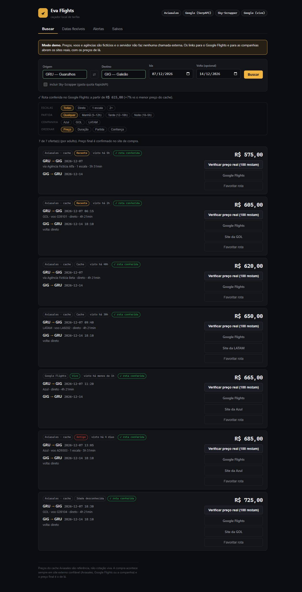
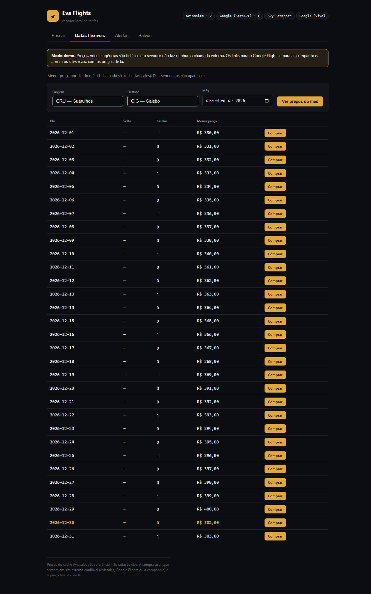
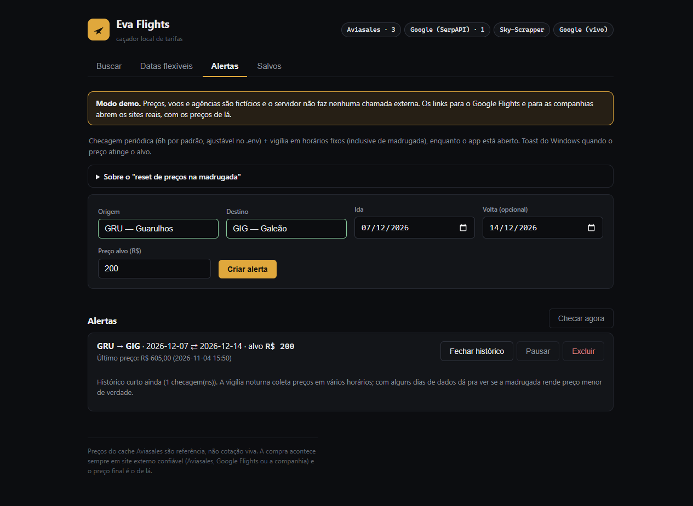
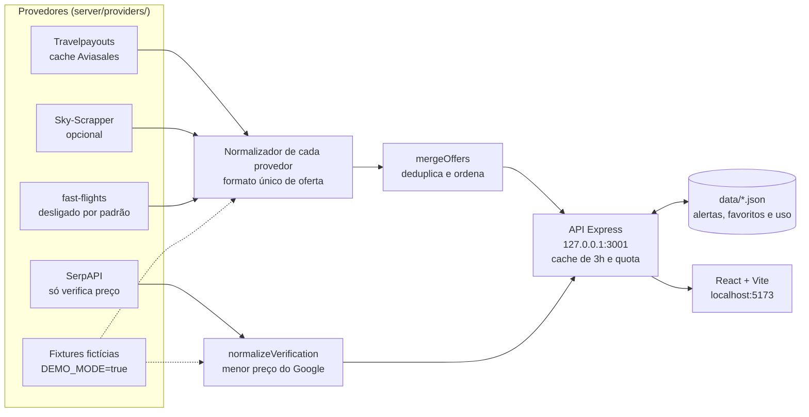

# Eva Flights

Buscador local de passagens aéreas: junta várias fontes gratuitas, mostra a idade de cada preço e avisa quando uma rota chega ao valor desejado. Nada é vendido aqui: os botões de compra abrem a Aviasales, o Google Flights ou o site da companhia.

Roda sem nenhuma chave em modo demo, com dados fictícios:

```bash
npm install
npm run demo
```

Depois abra http://localhost:5173.



## English summary

Eva Flights is a local flight fare finder built with Node.js, Express, React and Vite, storing data in JSON files. It merges several free sources (Travelpayouts, Sky-Scrapper via RapidAPI and, optionally, an unofficial Google Flights scraper), removes duplicate flights and shows how old each price is. SerpAPI is used only to check a cached price against Google Flights. Price alerts and a scheduled watch record prices by time of day, so the "cheaper at night" claim can be measured rather than assumed.

There is no official free API for live fares, so most prices are cached and the app says so. A monthly quota lock protects the free plans, one failing source becomes a warning instead of breaking the search, and the server only accepts connections from the local machine. `npm run demo` runs everything with made-up data and no API keys. Tests use `node:test` and never touch the network.

## O problema

Comparar passagem de graça é difícil. Não encontrei API oficial gratuita com preço vivo, e os preços de cache divergem do que o Google Flights mostra sem explicar por quê. Quem busca não sabe se o valor na tela ainda existe.

O Eva Flights não resolve a falta de preço vivo. Ele deixa claro de onde veio cada preço e quando foi visto, junta as fontes em uma lista só e permite conferir uma oferta antes de comprar.

## O que ele faz

- **Buscar:** junta as fontes, remove voos repetidos e filtra por escalas, horário e companhia. Sem resultado, sugere datas próximas.
- **Datas flexíveis:** menor preço de cada dia do mês, com uma chamada só.
- **Alertas:** preço alvo por rota, aviso do Windows ao atingir e histórico por faixa horária.
- **Salvos:** rotas favoritas e histórico de buscas.
- **Verificar preço real:** consulta o Google Flights pela SerpAPI e compara com o preço de cache.





## Como funciona



Não existe uma camada central de normalização: cada provedor exporta a própria função, e um teste garante que todas devolvem o mesmo formato. A explicação passo a passo está em [docs/COMO-FUNCIONA.md](docs/COMO-FUNCIONA.md).

## Como rodar

Requer Node 20 ou mais novo.

### Modo demo, sem chave

`npm run demo` já basta. Outro caminho é criar um `.env` só com `DEMO_MODE=true` e rodar `npm run dev`. No Windows, `start.bat` entra em modo demo quando não existe `.env`.

Preços, voos e agências são fictícios, e o servidor não chama nenhuma API. O autocomplete usa uma lista própria de aeroportos. Os dados ficam em `data/demo`, separados dos reais. Os links para o Google Flights e para as companhias continuam abrindo os sites de verdade.

### Com dados reais

1. Copie `.env.example` para `.env`.
2. Crie uma conta grátis em https://www.travelpayouts.com e coloque o token em `TRAVELPAYOUTS_TOKEN`.
3. Rode `npm run dev`.

O servidor sobe em `127.0.0.1:3001` e o app em http://localhost:5173.

| Fonte | Variável | Para que serve | Padrão |
|---|---|---|---|
| Travelpayouts | `TRAVELPAYOUTS_TOKEN` | Busca principal, datas flexíveis e alertas | Necessária fora do demo |
| SerpAPI | `SERPAPI_KEY` | Verificar o preço no Google Flights | Opcional |
| Sky-Scrapper (RapidAPI) | `RAPIDAPI_KEY` | Segunda fonte de busca, ligada por um checkbox | Opcional |
| fast-flights | `FASTFLIGHTS_DISABLED=false` | Preço do Google Flights sem chave, por scraper não oficial | Desligado |

O Sky-Scrapper é uma API de terceiros na RapidAPI, não um produto da Skyscanner. As demais variáveis estão comentadas em [.env.example](.env.example).

### Testes e build

```bash
npm test
```

```bash
npm run build
```

Os testes não usam rede nem chave: qualquer chamada para fora da própria máquina é bloqueada. Em 04/11/2026, `npm test` rodou 118 testes, com 118 aprovados.

## Decisões

**Fim da Amadeus.** A primeira versão usava a Amadeus Self-Service. O portal foi desativado em 17/07/2026, as chaves pararam de funcionar e sobrou o plano Enterprise, por contrato, que não serve para um app pessoal. O projeto migrou para a Data API da Travelpayouts: token grátis, mês inteiro em uma chamada e link de compra na Aviasales. O custo foi trocar cotação por cache.

**Preço de cache contra preço vivo.** Na pesquisa de 18/07/2026, não reconferida depois, não havia API oficial grátis de preço vivo: a Kiwi Tequila exigia volume mínimo de usuários e o ambiente de teste da Duffel trazia dados falsos. Então o app assume o cache e mostra a diferença:

- cada oferta tem um selo de idade: Vivo, Recente, Cache, Antigo ou Idade desconhecida;
- o botão **Verificar preço real** consulta o Google Flights na hora;
- com `SERPAPI_KEY`, a rota é conferida sozinha no máximo uma vez a cada 24h, e essa conferência automática gasta até 50 das 100 chamadas mensais previstas.

**Medir em vez de prometer.** Dizem que a passagem fica mais barata de madrugada. A pesquisa apontou um mito com um grão de verdade: não há reset à meia-noite, só cargas promocionais ocasionais. Em vez de afirmar qualquer coisa, a vigília (`WATCH_HOURS`) checa os alertas em horários fixos, e cada alerta mostra o menor preço por faixa horária. Este repositório não traz resultado dessa medição, porque ela depende de dias com o servidor ligado.

**Trava de quota.** `canCall` é consultado antes de gastar uma chamada paga pela quota, e não depois. Uma busca no Sky-Scrapper custa 3 chamadas, então só começa se as 3 couberem. Os limites estão em `server/usage.js`.

**Fonte que falha vira aviso.** Cada fonte tem o próprio tratamento de erro, e a busca só falha quando todas falham. O fast-flights tem timeout de 12 s.

**Só a própria máquina.** A API não tem login e gasta as quotas das chaves do `.env`, por isso escuta apenas em `127.0.0.1`.

**JSON em vez de banco.** O app é local e de uma pessoa só, então arquivos JSON bastam e não há dependência nativa para instalar no Windows.

## fast-flights: desligado por padrão

`fast-flights-ts` lê um RPC interno do Google Flights, sem chave e sem API oficial. Por isso vem desligado (`FASTFLIGHTS_DISABLED=true` no `.env.example`): pode quebrar quando o Google mudar o protocolo, pode ser bloqueado e pode contrariar os termos de uso do Google. Em 04/11/2026, numa consulta de ida e volta GRU→GIG, falhou com `RPC response missing flight data`.

Para ligar, use `FASTFLIGHTS_DISABLED=false` no `.env`, por sua conta e risco. Sem essa linha, a fonte fica desligada. Se ela falhar ou demorar, a busca continua com as outras e mostra um aviso.

## O que foi medido com dados reais

Em 04/11/2026, com o servidor real e só o `TRAVELPAYOUTS_TOKEN`:

| Busca | Resultado | Como repetir |
|---|---|---|
| GRU→GIG só ida, 07/12/2026 | 2 ofertas, nenhum aviso | `curl "http://127.0.0.1:3001/api/flights?origin=GRU&destination=GIG&departureDate=2026-12-07"` |
| GRU→GIG ida e volta, 10/12 a 20/12/2026 | 0 ofertas, 6 datas próximas com preço só de ida | `curl "http://127.0.0.1:3001/api/flights?origin=GRU&destination=GIG&departureDate=2026-12-10&returnDate=2026-12-20"` |

Foi uma rota e duas buscas, o que não permite generalizar. O resultado muda com o tempo, porque é cache. Cada busca gasta até 4 chamadas da Travelpayouts e, com `SERPAPI_KEY` preenchida, pode gastar 1 da SerpAPI.

## Limitações

**Dados**

- O cache pode vir vazio, sobretudo em ida e volta, como mostra a tabela acima. Vazio não significa que não existam voos.
- O endpoint principal (`/aviasales/v3/prices_for_dates`) não informa quando viu o preço, então essas ofertas aparecem como "Idade desconhecida".
- O `/v2/prices/latest` só responde por cidade. O cartão mostra SAO→RIO, e o preço pode ser de outro aeroporto da mesma cidade.
- O mesmo voo pode aparecer duas vezes, porque uma fonte traz a companhia e a outra só a agência.
- Em busca de ida e volta, as datas próximas podem ter preço só de ida. A tela avisa quando isso acontece.
- Em 04/11/2026, o Sky-Scrapper respondeu sem nenhum itinerário numa consulta GRU→GIG. O caminho completo dele só está coberto com dados fictícios.
- O `TRAVELPAYOUTS_MARKER` só foi testado na montagem do link, não numa compra real.

**Funcionamento**

- Alertas e vigília só rodam com o servidor aberto.
- O aviso de alerta foi feito para o Windows. Em outros sistemas não foi testado.
- O proxy do Vite aponta para a porta 3001. Mudar `PORT` exige mudar também `vite.config.js`.
- Avisos de fonte ficam no cache de 3h junto com o resultado.
- O contador de uso soma a chamada antes de ela sair, mesmo sem token configurado. O fast-flights não é contado.
- O mês da quota vira em UTC, não no horário local.
- O corpo de alertas e favoritos não é validado. A exposição é só local.
- O contador de chamadas restantes demora até 30 s para atualizar, e trocar de aba limpa os resultados.

**Dependências**

`npm audit` em 04/11/2026 aponta 16 pacotes vulneráveis (10 moderados, 5 altos e 1 crítico), depois de aplicado `npm audit fix` sem mudança de major:

- 9 são a cadeia opcional de `node-libcurl`, sem correção, incluindo o crítico (`tar`). `npm ls node-libcurl` mostra que ela não é instalada no Windows.
- `fast-flights-ts` aparece por depender dessa cadeia.
- `vite` e `esbuild` são só de desenvolvimento, e a correção exige o Vite 8.
- `node-notifier` e `uuid` exigem o `node-notifier` 12.
- `express` e `qs` não foram resolvidos pelo `npm audit fix`.

## Estrutura

```text
server/             API Express, quota, alertas e persistência em JSON
server/providers/   um arquivo por fonte e o modo demo
server/demo/        fixtures fictícias e entrada do npm run demo
shared/             tabela de companhias usada pelo servidor e pelo front
src/                interface React
tests/              testes com node:test
docs/               explicação do projeto e material de estudo
```

## Documentação

- [docs/COMO-FUNCIONA.md](docs/COMO-FUNCIONA.md): o projeto em linguagem simples.
- [docs/ESTUDO.md](docs/ESTUDO.md): 10 perguntas prováveis de entrevista, com respostas baseadas no código.

## Licença

Ainda não definida.

Travelpayouts, Aviasales, Google Flights, SerpAPI, RapidAPI, Sky-Scrapper e Skyscanner pertencem aos seus donos. Este projeto não tem vínculo com nenhum deles.
